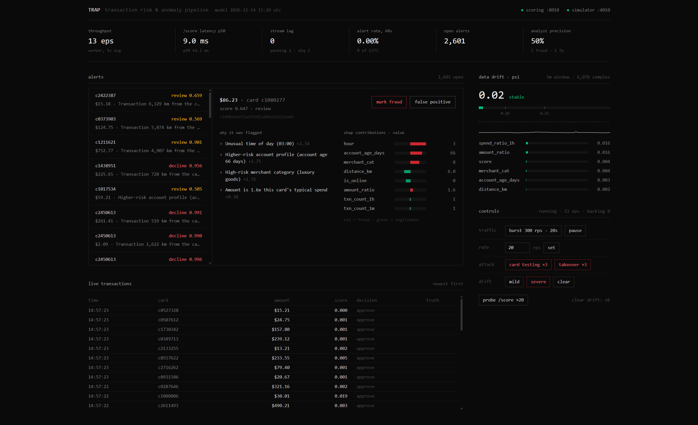
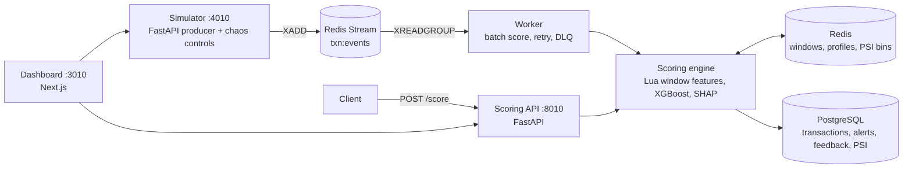

# TRAP: Transaction Risk & Anomaly Pipeline

Real-time card-fraud scoring with streaming velocity features, explainable decisions, and live data-drift monitoring, built from scratch.



> **All data is synthetic.** The model is trained on a generated dataset (~0.5% fraud), so the accuracy numbers below show the pipeline and methodology working, not real-world fraud-detection performance.

## What it does

A simulator produces card transactions into a Redis Stream. A scoring service computes sliding-window velocity features per card, scores each transaction with XGBoost, explains flagged ones with SHAP in plain English, and stores everything in Postgres. A drift monitor compares live traffic to the training distribution using Population Stability Index (PSI). A dashboard shows the live feed, an alert queue with a reason-code inspector and analyst feedback, drift status, and controls to cause chaos (traffic bursts, card-testing attacks, distribution drift).

## Architecture



| Piece | Port | Role |
|---|---|---|
| `dashboard/` | 3010 | Next.js (App Router) + TypeScript + Tailwind console |
| `simulator/` | 4010 | Synthetic traffic, card-testing/takeover attacks, bursts, drift injection, optional CSV replay |
| `scoring-api/` | 8010 | Scoring API, stream worker, model, SHAP, PSI |
| Redis 7 | 6379 | Stream, sliding-window feature store, PSI histograms, metrics |
| PostgreSQL 16 | 5433 | Transactions, alerts, analyst feedback, PSI snapshots |

## Results

Measured on one Windows machine ([FILL IN: CPU, RAM]). Redis and Postgres ran in Docker Desktop, and the load generator, API and worker shared the same machine.

### Model (synthetic data, ~0.5% fraud)

| Evaluation | AUC-PR |
|---|---|
| Time-based split (train days 0-19, test days 25-29) | **0.955** (random baseline 0.006) |
| Strict split: 30% of cards held out entirely, mean of 3 holdouts | **0.880 ± 0.057** |
| Strict split, without `account_age_days` and `distance_km` | 0.758 ± 0.090 |

At the validation-chosen threshold the time-split test gave precision 0.991 and recall 0.833. Ablations (`python -m ml.ablation`) showed the model isn't memorizing card identities: dropping `account_age_days` left the score unchanged within noise. The strict-split holdout has only about 70 fraud rows per run, so differences below ~0.05 are noise.

### Training-serving parity

An integration test replays 6,043 historical transactions through the Redis Lua feature extractor. **100% of rows match the offline training features exactly**, and the served model reproduces the training AUC-PR (0.9550 vs 0.9550).

### Serving performance

Final run, after the fix described below. Full tables are in [`docs/benchmark_latest.md`](docs/benchmark_latest.md), and every run is in `docs/benchmark_results.json`.

| Measurement | Result |
|---|---|
| `/score` server-side (features + predict), normal traffic | p50 2.5 ms · p95 3.4 ms · p99 14.4 ms |
| `/score` server-side, flagged traffic (adds SHAP) | p50 4.3 ms · p95 5.4 ms · p99 20.5 ms |
| `/score` client round trip (localhost, keep-alive) | p50 4.7 ms · p95 5.8 ms · p99 16.6 ms |
| `/score` under 4 / 16 concurrent clients | ~235 / ~243 req/s, 0 errors (one uvicorn process) |
| Stream throughput, one worker, including Postgres commits | median ~2,100 events/s (range 1,580-3,060 over 3 runs) |
| Burst test at 300 events/s | backlog stayed at 0, nothing throttled |

Stream throughput varied about 2x between runs because the benchmark shares the machine with Docker and other processes. Quote it as a range.

### Drift detection

| State | Overall PSI | Status |
|---|---|---|
| Baseline traffic | 0.078 | stable |
| After "severe" drift injection | 2.72 | significant |
| After clearing drift | 0.053 | stable |

Drift knobs moved only the features they target (`amount`, `distance_km`, `is_online`, `hour`, plus derived `amount_ratio`, `spend_ratio_1h` and the model `score`). Untouched features stayed below 0.01.

## Design decisions

- **Training-serving parity by contract.** `scoring-api/app/schema.py` defines the exact window semantics: `(t-w, t]`, the current transaction included, history mean excluding it, integer milliseconds. The offline generator and the online extractor both follow it, and a test proves they agree.
- **One atomic Lua script per event** updates the sliding windows and card profile in a single Redis round trip, so concurrent workers can't race on the same card.
- **Idempotent redelivery.** Window members are keyed `txn_id|amount`, so a redelivered stream message doesn't double-count.
- **At-least-once consumption with a DLQ.** Messages are ACKed only after the Postgres commit. Invalid payloads go straight to `txn:dlq`, and transient failures are retried via `XAUTOCLAIM` and dead-lettered after `max_retries`. A failed batch is re-run one message at a time to isolate a poison pill.
- **SHAP only for flagged transactions** (plus `/explain/{txn_id}` on demand), which keeps approvals fast. Reasons are plain-English text built from the top positive contributions.
- **Rolling-window PSI** is computed from per-minute Redis histograms, compared with training-time bins stored in `metadata.json`.
- **Honest evaluation.** Time-based split, a strict card-holdout split, feature ablations, and AUC-PR as the headline metric.

## A performance investigation

The first benchmark showed `/score` capped at ~86 req/s regardless of client count, and batch persistence taking ~95 ms. My first hypothesis (slow `fsync` on Postgres commits) was **refuted** by a measurement: commits took 1-2 ms. A second profile isolated host-to-Postgres writes: a 100-row `executemany` took **48 ms via `localhost` but 6 ms via `127.0.0.1`**. Switching the connection URL fixed it. `/score` throughput rose from 86 to ~243 req/s, client p99 fell from 45.6 to 16.6 ms, and stream throughput roughly 2.5x (844 events/s median to ~2,100). The `localhost` slowness is an environment-specific finding on Windows with Docker Desktop. I did not root-cause it further.

## Run it locally (Windows CMD)

Requirements: Docker Desktop, Python 3.11 or 3.12, Node 18.18+.

```bat
:: 1. infrastructure (Postgres schema is applied automatically on first start)
docker compose up -d

:: 2. scoring API: train the model, then start API and worker (two windows)
cd scoring-api
py -3.12 -m venv .venv
.venv\Scripts\activate.bat
pip install -r requirements.txt
python -m ml.train
python -m pytest tests -q -s
uvicorn app.main:app --port 8010
:: second window, same venv:
python -m app.worker

:: 3. simulator (own venv)
cd simulator
python -m venv .venv
.venv\Scripts\activate.bat
pip install -r requirements.txt
uvicorn app.main:app --host 127.0.0.1 --port 4010

:: 4. dashboard
cd dashboard
npm install
npm run dev
```

Open http://127.0.0.1:3010. Chaos controls are also available as a CLI: `python scripts\chaos.py status | burst 300 20 | attack card_testing 3 | drift severe 30 | drift-clear`.

Reproduce the benchmark with the API and worker running: `scoring-api\.venv\Scripts\python scripts\benchmark.py` (use `--quick` first).

If port 5432 is free on your machine you can change the Postgres mapping in `docker-compose.yml`; this project uses 5433 to avoid clashing with a local install. Use `127.0.0.1` rather than `localhost` for all services on Windows.

## API (scoring service)

| Endpoint | Purpose |
|---|---|
| `POST /score` | Score one transaction synchronously, with SHAP reasons if flagged |
| `POST /ingest` | Publish a transaction to the Redis Stream |
| `GET /explain/{txn_id}` | SHAP explanation for any stored transaction |
| `GET /metrics` · `GET /stats` · `GET /health` | Throughput, latency percentiles, stream lag, DLQ size, alert counts |
| `GET /drift` · `GET /drift/history` · `POST /drift/reset` | Current PSI per feature, history, window reset |
| `GET /transactions` · `GET /alerts` · `POST /alerts/{txn_id}/feedback` | Feed, alert queue, analyst Mark Fraud / False Positive |

Interactive docs at http://127.0.0.1:8010/docs.

## Limitations and known issues

- **Synthetic data only.** The simulator's attacks mirror the training generator, so detection of simulated attacks (27 of 27 card-testing events flagged, ~0.03% of legitimate traffic flagged) is in-distribution and doesn't predict real-world accuracy. The Kaggle CSV replay path is only a stress and drift demo.
- **Idle end-to-end latency is ~94 ms** (enqueue to a persisted row, no background load) and is **not yet explained**. Under sustained load it was lower (25-150 ms p50, non-monotonic across levels). Each level had only 50-90 probes, so tail percentiles are effectively the maximum. Likely causes (untested): the worker's blocking read or housekeeping on an idle stream.
- `/score` server-side p99 (14.4 ms in the final run) sits close to a 15 ms budget. p50 and p95 are comfortably lower.
- Benchmarks are single-machine, with the load generator competing for CPU. Absolute numbers aren't portable.
- **One worker.** Running several consumers raises throughput, but per-card ordering of window features could break. Partitioning the stream by card is the standard fix and is untested here.
- The feedback loop stores analyst labels but doesn't yet retrain the model.
- Postgres is not tuned, and the demo tables grow quickly at 20+ events/s.

## Project structure

```
TRAP/
├── docker-compose.yml
├── infra/postgres/init/001_schema.sql
├── scoring-api/
│   ├── app/        # schema (feature contract), features (Redis Lua), model (XGBoost+SHAP),
│   │               # drift (PSI), engine, worker (stream + DLQ), db, main (FastAPI)
│   ├── ml/         # data_gen, train, ablation
│   ├── artifacts/  # model.json, metadata.json (PSI reference), ablation.json
│   └── tests/      # training-serving parity tests
├── simulator/      # traffic generator, chaos controls, CSV replay, calibration tests
├── dashboard/      # Next.js console
├── scripts/        # benchmark.py, chaos.py, profile_io.py, inspect_drift.py, smoke_phase2.py
└── docs/           # benchmark results, screenshot
```
